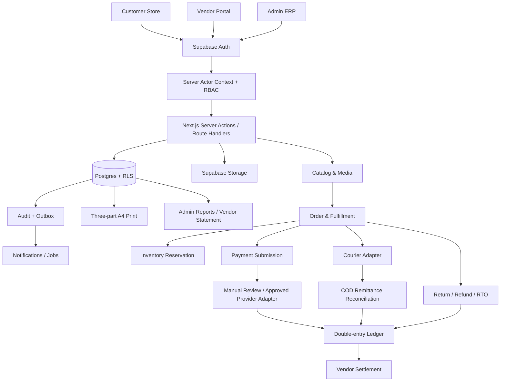

# PANCHAGARH — SYSTEM INTEGRATION MAP
**Version 2.0 | 2026-11-11 | বাংলা**

এই ডকুমেন্টটি Frontend, Backend, Supabase, Storage, Payment, Courier, Finance, Print এবং AI tooling-এর মধ্যে কোন module কীভাবে যুক্ত হবে তার একক মানচিত্র। এটি Existing ZIP-এর inventory + Master Specification + নতুন Hybrid Payment requirement মিলিয়ে তৈরি। এটি কোনো live integration connected আছে—এমন দাবি নয়।

## ১. Global data flow

## ২. Module connection matrix

| Module | Reads from | Writes to | Downstream connection |
|---|---|---|---|
| Identity | Supabase Auth, profiles, role assignments | profile/security/audit | every protected API |
| Storefront | public branding, categories, active products | cart, customer request | checkout |
| Customer Account | own profile, addresses, orders, payment, wishlist | own address/wishlist/return/support | order/support |
| Vendor Portal | own vendor, product proposals, allocations, stock, statements | own drafts, dispatch lot, claims, payout request | admin review |
| Product Studio | categories, vendor proposals, media | product/variant/version/approval | public catalog, stock |
| Media Pipeline | private staging objects, image metadata | media records, approved public objects | catalog/PDP |
| Cart/Checkout | product/variant, stock, delivery rates, payment methods | order, stock reservation, payment submission | fulfillment/payment |
| Orders | customer, line snapshot, risk, stock | order/status history/fulfillment groups | courier, print, finance |
| Warehouse | consignment lot, QC, stock | QC decision, stock movement | order allocation |
| Payment | provider registry, order, submission | verification, transaction, payment allocation | ledger, order paid state |
| Courier | shipment, courier config | tracking, COD collection, remittance | order, receivable |
| Ledger | verified financial events, returns, courier remittance | journals, payable/receivable | settlement/report |
| Returns | order/payment/shipment/stock | return case, refund request, stock disposition | ledger, support |
| Fraud | customer/order/courier history | risk flag/review | confirmation queue |
| Print | order, allocation, role, template | print job/history | customer/warehouse/accounts |
| Reporting | ledger/read models/orders | export snapshots | admin/vendor statements |

## ৩. Canonical event chain

1. `customer.registered`
2. `cart.validated`
3. `order.created`
4. `inventory.reserved`
5. `order.confirmed`
6. `fulfillment.group_allocated`
7. `consignment.received`
8. `stock.qc_accepted` / `stock.qc_rejected`
9. `shipment.created`
10. `payment.submitted` (manual payment only)
11. `payment.verification_requested`
12. `payment.verified` OR `payment.rejected` OR `payment.needs_review`
13. `ledger.journal_posted` (only after verified financial event)
14. `courier.cod_collected`
15. `courier.remittance_received`
16. `courier.remittance_reconciled`
17. `order.delivered`
18. `supplier.payable_matured`
19. `supplier.settlement_requested`
20. `supplier.settlement_approved`
21. `supplier.payout_recorded`
22. `return.requested` / `refund.approved` / `stock.returned`
23. `ledger.reversal_posted` when a posted transaction must be corrected

Events are stored in a transactional outbox; consumers must be idempotent. Event order and state transitions must be validated; no browser-originated event can directly post ledger journals.

## ৪. Payment integration states

| Provider | Candidate status | Manual mode | Automatic mode | Gate |
|---|---|---|---|---|
| COD | Existing approved model | not applicable | not applicable | retain unless Owner explicitly removes |
| bKash | Candidate | manual TrxID + merchant statement | official API only if provider approves product/credentials | VERIFY_REQUIRED |
| Rocket | Candidate | manual TrxID + official account statement | official API only if available/authorized | VERIFY_REQUIRED |
| Nagad | Candidate | manual TrxID + merchant statement | official API only if available/authorized | VERIFY_REQUIRED |
| National | ambiguous label | not defined | not defined | exact institution/channel required |

"Free automatic verification" is not guaranteed. A provider's online checkout/gateway is not the same thing as transaction verification and is out of scope unless Owner explicitly changes the no-gateway rule.

## ৫. Data boundary matrix

| Data | Customer | Vendor | Marketing | Packaging | Accounts | Super Admin |
|---|---:|---:|---:|---:|---:|---:|
| Public product/title/price | yes | own/relevant | yes | relevant | yes | yes |
| Supplier cost/profit | no | no (own supplier terms only if approved business rule) | no | no | yes | yes |
| Platform margin/net profit | no | no | no | no | permission | yes |
| Own order status | own | assigned items only | permitted operations | packing scope | yes | yes |
| Customer full address/phone | own | masked/need-to-know | permission/need-to-know | delivery task only | yes | yes |
| Payment TrxID | own | no | no | no | yes | yes |
| Provider credentials | no | no | no | no | no by default | restricted settings only |
| Ledger journal | no | own statement summary only | no | no | permission | yes |
| KYC/bank docs | own | own | no | no | restricted | restricted |

## ৬. Failure and recovery connections
- DB transaction fails: no downstream event is published.
- Outbox worker fails: retry with idempotency; do not duplicate payment/ledger/courier actions.
- Provider timeout: keep payment pending; manual queue.
- Courier API timeout: shipment booking status unknown; query provider before retry to avoid duplicate booking.
- Ledger posting fails: financial event remains unposted and enters reconciliation queue; never mark Paid while journal failed.
- Storage upload fails: retain draft, allow retry, clean orphan only via reviewed job.
- Print fails: preserve order and print queue; retry print only, not order mutation.

## ৭. Existing ZIP file mapping

| Existing file | Domain responsibility | Next step |
|---|---|---|
| `app/api/orders/route.ts` | order creation | audit auth, price, stock, idempotency |
| `app/api/payments/manual-bkash/submissions/route.ts` | manual bKash submission | generalize only after provider scope approval |
| `app/api/admin/workspace/route.ts` | admin workspace and actions | split services carefully; audit permission checks |
| `app/api/webhooks/courier/route.ts` | courier webhook | signature/replay/idempotency tests |
| `src/lib/admin/phase4a-service.ts` | users/orders/admin core | inspect security and persistence |
| `src/lib/admin/phase4b-service.ts` | courier/print/vendor escrow | preserve current functions; test boundaries |
| `src/lib/admin/phase4c-service.ts` | settings/expenses/automation | quarantine prohibited integration behavior |
| `src/lib/admin/phase6-service.ts` | backup/reviews/remittance/webhook | validate live-vs-simulation claims |
| `src/lib/admin/phase7-service.ts` | consignment/ledger/refund/campaign | prohibited flash campaign must be disabled/quarantined |
| `src/lib/db/repository.ts` | persistence abstraction | identify JSON vs Supabase source of truth |
| `src/components/admin/print-engine-panel.tsx` | existing A4 print | upgrade, do not rebuild |
| `src/components/admin/product-studio-panel.tsx` | product/media UI | replace URL-only flow with direct upload after audit |
| `src/components/admin/phase7-portal-panel.tsx` | vendor/consignment panels | extract dedicated `/vendor` portal; isolate data |

## ৮. Acceptance gates
- No module claims integration status from placeholder `.env`.
- Every data mutation has server auth, Zod validation, idempotency where needed, RLS, audit.
- Each event has producer, consumer, retry policy, duplicate policy and failure state.
- Each provider integration has status `NOT_CONFIGURED`, `REQUESTED`, `SANDBOX`, `CONNECTED`, `TESTED`, `PRODUCTION_READY`, or `SUSPENDED`.
- Production readiness requires provider confirmation, sandbox evidence, security review, reconciliation test and Owner approval.
